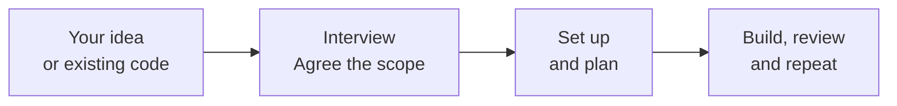
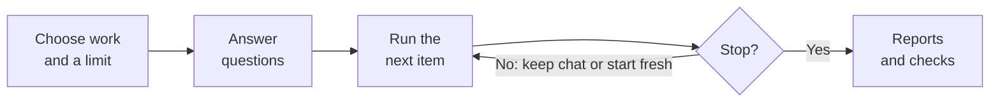

# framework

### Build software with AI. Keep control of the plan.

Turn an idea or an existing codebase into an ordered plan. 
Let models do the work, review the results, and keep what the project learns.

**Native desktop · Windows · Manual & automatic runs**

[Why framework](#why-framework) · [How it works](#from-idea-to-working-software) · [Features](#run-one-task-or-a-whole-batch) · [Download and get started](#get-started)

*The plan, the work, and your verdict — together in one workspace.*

## Why framework

An AI chat can write code. A project also needs a clear scope, an ordered plan, a way to judge the result,
and a record of what worked. framework brings those together, from the first idea to the next change.

| What you get | Why it matters |
|---|---|
| **A plan the app keeps** | Tasks, steps and review points stay with the project across chats and models. The app enforces the rules for changing them. |
| **Your verdict on the work** | Every task run ends with a report and manual checks. A model cannot accept a review on your behalf. |
| **Automatic runs with limits** | Choose the lists, the number of items and when to start fresh chats. Runs stop at review points, failures or your limit. |
| **Knowledge that carries forward** | Models record useful findings and accepted fixes, then search them when later work needs them. |
| **Changes you can inspect** | See the files a run changed, compare before and after, and revert a change, a file or a run. |

## From idea to working software

Start with an empty folder or an existing codebase. Describe what you want in your own words; the model asks
questions, reads what it needs, and agrees the scope with you before changing code.

**Run next task** gives the model the next open item, including its current steps and review requirements.
**Accept** closes a task waiting for your judgment. **Reject** sends your reason back: the model plans
corrective steps first, so you can inspect the correction before the next run builds it.

<strong>See the interview: pick an answer or write your own</strong>

 

## Run one task or a whole batch

Use **Manual** mode when you want to stay close to each task. Switch to **Automatic** when the plan is ready
and you want several items worked through in order.

- **Choose the scope.** Select the lists to work in, set an item limit, and arrange the working order.
- **Answer questions up front.** An initial pass asks about the planned work before the first item starts.
- **Keep chats manageable.** Start a fresh chat after a fixed number of items, or let the model's context-health
  judgment guide the switch: green continues, orange does one more item, red starts fresh.
- **Keep the stopping points.** Review requirements, failed or unfinished tasks, your limit and **Stop** end the run.
  Permissions and questions discovered during work can still need your answer.

Each item keeps its own report and checks. You can also let fixed issues wait for review while the run carries
on, then judge those fixes together afterwards.

## A project that remembers what it learns

The project's documents give each run its scope, current decisions and work to do. **Documentation** keeps
useful findings; **Solved issues** keeps the symptom, cause and accepted fix of a defect. Models search for
relevant sections instead of reading the whole knowledge base each time.

Need your own record of design decisions, release checks or research? **New document…** creates a list, text
or searchable knowledge base. Write its rules in plain language: when a model writes, what an entry contains,
and when a model reads it. Those rules accompany every run.

<strong>See a custom document with rules of its own</strong>

 

## Review the code and the plan

**Files** shows the code folder, highlights files changed by the model's edit tools, and lets you choose a run
to inspect. Compare changes inline or side by side. Revert one change, one file, or the whole run; a change
edited again since is left alone and named in the result. Reverting a run also restores its task's checkboxes.

The plan is reviewable too. Ask a model to reword, reorder or remove open items: its proposal appears beside
the current plan, with **Apply** and **Discard**. Applied proposals can be reverted. You can also rearrange
the working order, skip an uncertain item, or choose an item to run now.

## Choose how you work

| Feature | What you can do |
|---|---|
| **A model for a particular task** | Choose a model and effort for an item. It runs in its own chat; the main chat keeps its model. |
| **Usage and context in view** | See run duration and reported tokens, subscription usage where available, and the model's guidance on when to start fresh. |
| **Tools for your project** | Connect MCP servers per project or across projects in Settings. Models can propose a server for you to approve. |
| **Permissions you control** | Pick a permission mode; allow a request once, always allow it, or deny it. Review saved rules in **Allowed**. |
| **Screenshots, files and chat history** | Attach designs, code, logs or PDFs. Search earlier chats, reopen them, or edit a sent message and continue from there. |
| **Several projects at once** | Leave a project while its model works. Its Home card shows whether it is working, waiting for you, or finished. |
| **A workspace that fits** | Move and resize Chat and Output, keep a layout per project, and choose a light or dark theme. |
| **Portable project records** | Export the documents, rules and optional chats you choose, then import them and select a code folder. |
| **Help inside the app** | The **?** beside Settings opens a short illustrated guide, from creating a project to reviewing a task. |

<strong>See the project library</strong>

 

## Your code and your project records, kept separately

Models work directly in the code folder you choose. framework keeps its documents, chats, attachments and settings
as local JSON and files in `%APPDATA%\fmwk\`, without adding its own bookkeeping files to your codebase.
The app needs no account or cloud service of its own.

An exported project contains the selected project records, **not the code folder**. Keep or transfer your code
separately, then point the imported project at it.

## Get started

**Runs on Windows 10 or 11; tested on Windows 11.** A macOS release is not available yet.

**[Download the installer](../../releases/latest)** and run it; there is nothing to install before it, since .NET ships inside the app. The app
installs as **fmwk**.

**Which installer?** Both install the same app; pick one.

- **fmwk-win-Setup.exe** (recommended): one click, nothing to answer. It installs for you alone, without admin rights,
  into `%LocalAppData%\fmwk`, and adds shortcuts to the Start menu and the desktop.
- **fmwk-win.msi**: a classic setup wizard. It asks whether to install for you alone, or for everyone on this PC in
  Program Files, which needs admin rights. Choose it if several people share the PC, or if your IT department installs
  software with MSI packages.

**Settings → About** shows where the app is installed. Your projects, chats and settings are kept apart from it, in
`%APPDATA%\fmwk`, so updating or removing the app keeps them. The installer is not signed yet, so Windows may say
"Windows protected your PC": choose **More info → Run anyway**.

Choose a connection in **Settings → Add connection**:

| Connection | What you need |
|---|---|
| **ChatGPT** | [Codex](https://github.com/openai/codex) **0.157.1 or newer**, signed in with your ChatGPT subscription. If it is missing, Settings offers **Install**, with OpenAI's own installer and no Node.js; if too old, **Update**, with Codex's own updater. |
| **Claude** | [Claude Code](https://code.claude.com/docs/en/setup) **2.1.283 or newer**, signed in with your Claude subscription. If it is missing, Settings offers **Install**, with Anthropic's own installer and no Node.js; if too old, **Update**, with Claude Code's own updater. |
| **Local models** | [LM Studio](https://lmstudio.ai/) with its server running and a model loaded, plus Claude Code, which drives the local model. Use a loaded context of at least **100k**, as the app advises. No subscription is used for this connection. |

The app checks only the engines your connections need, and installs or updates one only after you say yes. Provider
sign-in stays with the official engines, and the available models and efforts are read from the connections.

1. Open **Settings**, add a connection, and sign in or connect its local server.
2. Press **New project** and choose a name and a folder — empty, existing, or new.
3. Describe what you want in the chat and press **Start interview**.
4. Agree the scope, run setup and planning, then work through the plan.

## Built with its own method

framework was built using the same method it brings to your projects: agree the scope, make a plan,
work through it one task at a time, and review the results. The app grew out of that experience.

---

framework is independent of OpenAI and Anthropic. Its subscription connections run their official, unmodified tools
under your own sign-in.
