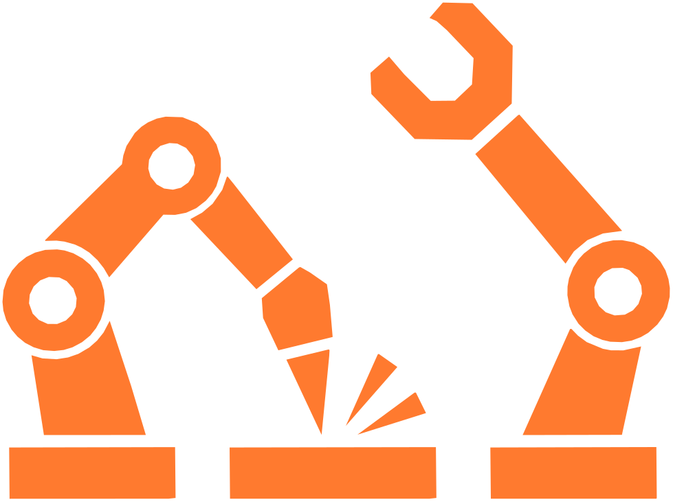
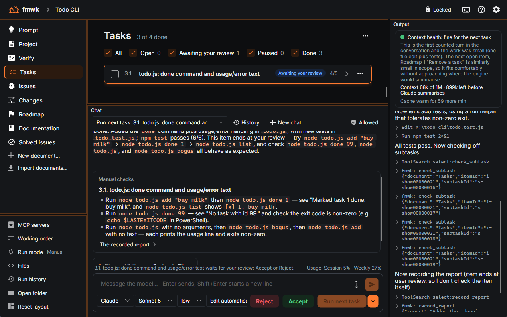
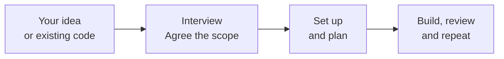
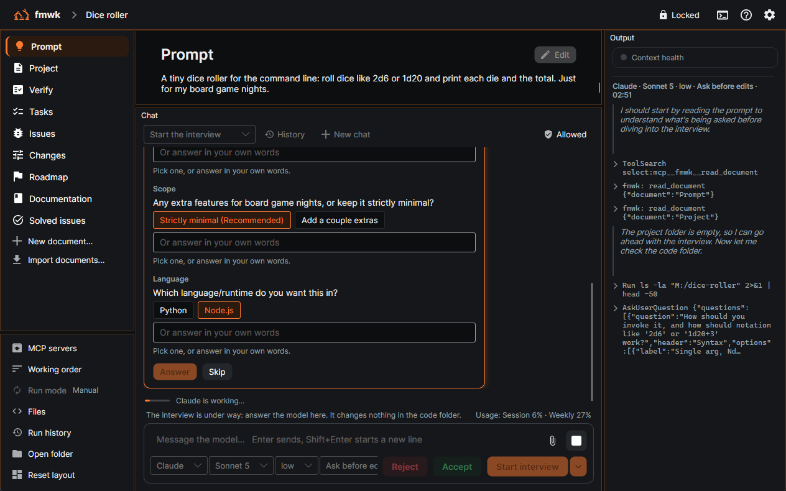
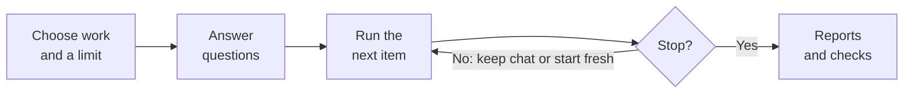
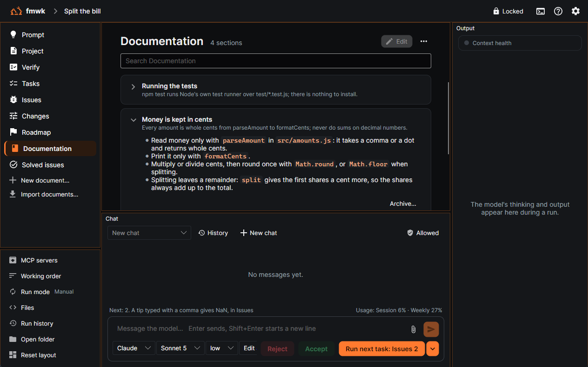
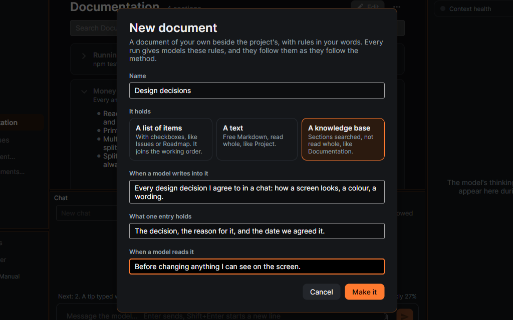
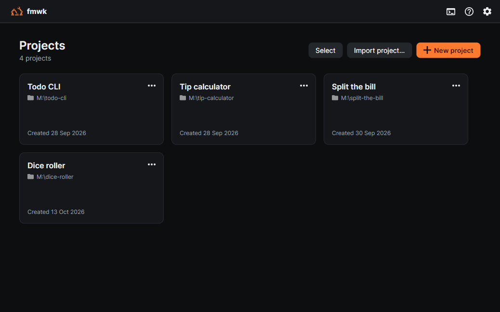

# framework

### Build software with AI. Keep control of the plan.

Turn an idea or an existing codebase into an ordered plan. 
Let models do the work, review the results, and keep what the project learns.

**Native desktop · Windows · Manual & automatic runs**

[Why framework](#why-framework) · [How it works](#from-idea-to-working-software) · [Features](#run-one-task-or-a-whole-batch) · [Download and get started](#get-started)

*The plan, the work, and your verdict — together in one workspace.*

## Why framework

An AI chat can write code. A project also needs a clear scope, an ordered plan, a way to judge the result,
and a record of what worked. framework brings those together, from the first idea to the next change.

| What you get | Why it matters |
|---|---|
| **A plan the app keeps** | Tasks, steps and review points stay with the project across chats and models. The app enforces the rules for changing them. |
| **Your verdict on the work** | Every task run ends with a report and manual checks. A model cannot accept a review on your behalf. |
| **Automatic runs with limits** | Choose the lists, the number of items and when to start fresh chats. Runs stop at review points, failures or your limit. |
| **Knowledge that carries forward** | Models record useful findings and accepted fixes, then search them when later work needs them. |
| **Changes you can inspect** | See every file a task changed, its commands' work included, compare it with the commit taken before the task, and take the whole task back. |

## From idea to working software

Start with an empty folder or an existing codebase. Describe what you want in your own words; the model asks
questions, reads what it needs, and agrees the scope with you before changing code.

**Run next task** gives the model the next open item, including its current steps and review requirements.
**Accept** closes a task waiting for your judgment. **Reject** writes your reason into the task and runs nothing:
when you are ready, **Fix** gives the model the task with your reasons, and it plans its corrective steps before it builds them.
A plain chat message only talks: if the model wants to change files or run commands, a card asks you first, and work on
an item goes on only from the run button.

<strong>See the interview: pick an answer or write your own</strong>

 

## Run one task or a whole batch

Use **Manual** mode when you want to stay close to each task. Switch to **Automatic** when the plan is ready
and you want several items worked through in order.

- **Choose the scope.** Select the lists to work in, set an item limit, and arrange the working order.
- **Answer questions up front.** An initial pass asks about the planned work before the first item starts.
- **Keep chats manageable.** Start a fresh chat after a fixed number of items, or let the model's context-health
  judgment guide the switch: green continues, orange does one more item, red starts fresh.
- **Keep the stopping points.** Review requirements, failed or unfinished tasks, your limit and **Stop** end the run.
  Permissions and questions discovered during work can still need your answer.

Each item keeps its own report and checks. You can also let fixed issues wait for review while the run carries
on, then judge those fixes together afterwards.

## A project that remembers what it learns

The project's documents give each run its scope, what you decided and work to do. **Verify** holds the checks every
task must pass before it is ticked, and every run is given it. **Documentation** keeps useful findings and the
models' own choices; **Solved issues** keeps the symptom, cause and accepted fix of a defect. Models search for
relevant sections instead of reading the whole knowledge base each time.

Need your own record of design decisions, release checks or research? **New document…** creates a list, text
or searchable knowledge base. Write its rules in plain language: when a model writes, what an entry contains,
and when a model reads it. Those rules accompany every run. When a document or a reference document is no
longer needed, set it inactive: you can still read it, and models leave it alone until you activate it again.

As a project grows, archive what is finished. **Archive done items** moves the done tasks you choose into an archive
under their list, each keeping its number, and **Archive…** does the same for sections of Documentation or of your own
documents. Anything archived by mistake can be restored. Models work from what is current: they read an archive only when you ask them to, and you allow each
read on a card.

When a project changes course, say from a web app to a game in Unreal, agree on the new direction with the model in
the chat and confirm it on a card, ticking the documents the change may touch. Project then says plainly that the
direction changed, and **Inspect and rebuild the project** comes first in the working order. Its run archives what no
longer fits in those documents, and only that: old lines of Project and Verify go to their archive with the new ones in
their place, outdated passages of Prompt are struck through, and old open items and articles are archived, with new
items in their place. You judge it all at its review, and can take it back. An item that still asks for the old
direction is not built either way until you say how.

<strong>See a custom document with rules of its own</strong>

 

## Review the code and the plan

Before every task, the app commits your code folder with git and keeps the documents beside it. You need not know
git: before the first task the app checks for it and offers to set it up, and a project without it is asked again before
its next task.
**Files** shows
the code folder and highlights every file that differs from that commit, whether the model's edits or its commands
changed it, and lets you choose a task to inspect. Compare changes inline or side by side. Take the whole task
back, code and documents together, with **Back to before…**, here or in **Run history**.

The plan is reviewable too. Ask a model to reword, reorder or remove open items: its proposal appears beside
the current plan, the words that change highlighted inside each item, with **Apply** and **Discard**. Applied
proposals can be reverted. You can also rearrange
the working order, pause an item, or choose an item to run now.

Documents open locked, so reading never ticks a box by accident, and you can select and copy across several items at
once. Unlock one with the lock in the top bar to tick items, edit their words and steps in place, or add and remove
items by hand. Checkboxes above a list show or hide its open, waiting, paused and done items.

## Choose how you work

| Feature | What you can do |
|---|---|
| **A model for a particular task** | Choose a model and effort for an item. It runs in its own chat; the main chat keeps its model. |
| **Usage and context in view** | See run duration and reported tokens, subscription usage where available, and the model's guidance on when to start fresh. |
| **Tools for your project** | Connect MCP servers per project or across projects in Settings. Models can propose a server for you to approve. |
| **Permissions you control** | Pick a permission mode; allow a request once, always allow it, or deny it. Review saved rules in **Allowed**. |
| **Screenshots, files and chat history** | Attach designs, code, logs or PDFs; a long paste becomes an attached file, so the message box keeps only your words. Search earlier chats, reopen them, or edit a sent message and continue from there. |
| **Several projects at once** | Leave a project while its model works. Its Home card shows whether it is working, waiting for you, or finished. Select several on Home to remove them together, from the app only or with their code folders. |
| **Process Monitor** | See every process the models started, in every project, still running or not: the command, the chat and run, how long it ran. End one that hangs; nothing is ended for you. |
| **A workspace that fits** | Move and resize Chat and Output, keep a layout per project, and choose a light or dark theme. |
| **Portable project knowledge** | Export the documents you choose, each with or without its archive. Import them as a new project, or into a project you already have: a document whose name it has comes in renamed or merged into its own, and your own documents come in inactive until you activate them. |
| **Help inside the app** | The **?** beside Settings opens a short illustrated guide, from creating a project to reviewing a task. |

<strong>See the project library</strong>

 

## Your code and your project records, kept separately

Models work directly in the code folder you choose. framework keeps its documents, chats, attachments and settings
as local JSON and files in `%APPDATA%\fmwk\`, without adding its own bookkeeping files to your codebase.
The app needs no account or cloud service of its own.

An exported project contains only the documents you selected: **not the code folder**, its chats or its settings. Keep
or transfer your code separately, then point the imported project at it.

## Get started

**Runs on Windows 10 or 11; tested on Windows 11.** A macOS release is not available yet.

**[Download the installer](../../releases/latest)** and run it; there is nothing to install before it, since .NET ships inside the app. The app
installs as **fmwk**.

**Which installer?** Both install the same app; pick one.

- **fmwk-win-Setup.exe** (recommended): one click, nothing to answer. It installs for you alone, without admin rights,
  into `%LocalAppData%\fmwk`, and adds shortcuts to the Start menu and the desktop.
- **fmwk-win.msi**: a classic setup wizard. It asks whether to install for you alone, or for everyone on this PC in
  Program Files, which needs admin rights. Choose it if several people share the PC, or if your IT department installs
  software with MSI packages.

**Settings → About** shows where the app is installed. Your projects, chats and settings are kept apart from it, in
`%APPDATA%\fmwk`, so updating or removing the app keeps them. The installer is not signed yet, so Windows may say
"Windows protected your PC": choose **More info → Run anyway**.

Choose a connection in **Settings → Add connection**:

| Connection | What you need |
|---|---|
| **ChatGPT** | [Codex](https://github.com/openai/codex) **0.157.1 or newer**, signed in with your ChatGPT subscription. If it is missing, Settings offers **Install**, with OpenAI's own installer and no Node.js; if too old, **Update**, with Codex's own updater. |
| **Claude** | [Claude Code](https://code.claude.com/docs/en/setup) **2.1.283 or newer**, signed in with your Claude subscription. If it is missing, Settings offers **Install**, with Anthropic's own installer and no Node.js; if too old, **Update**, with Claude Code's own updater. |
| **Local models** | [LM Studio](https://lmstudio.ai/) with its server running and a model loaded, plus Claude Code, which drives the local model. Use a loaded context of at least **100k**, as the app advises. No subscription is used for this connection. |

The app checks only the engines your connections need, and installs or updates one only after you say yes. Provider
sign-in stays with the official engines, and the available models and efforts are read from the connections.

1. Open **Settings**, add a connection, and sign in or connect its local server.
2. Press **New project** and choose a name and a folder — empty, existing, or new.
3. Describe what you want in the chat and press **Start interview**.
4. Agree the scope, run setup and planning, then work through the plan.

## Built with its own method

framework was built using the same method it brings to your projects: agree the scope, make a plan,
work through it one task at a time, and review the results. The app grew out of that experience.

---

framework is independent of OpenAI and Anthropic. Its subscription connections run their official, unmodified tools
under your own sign-in.
